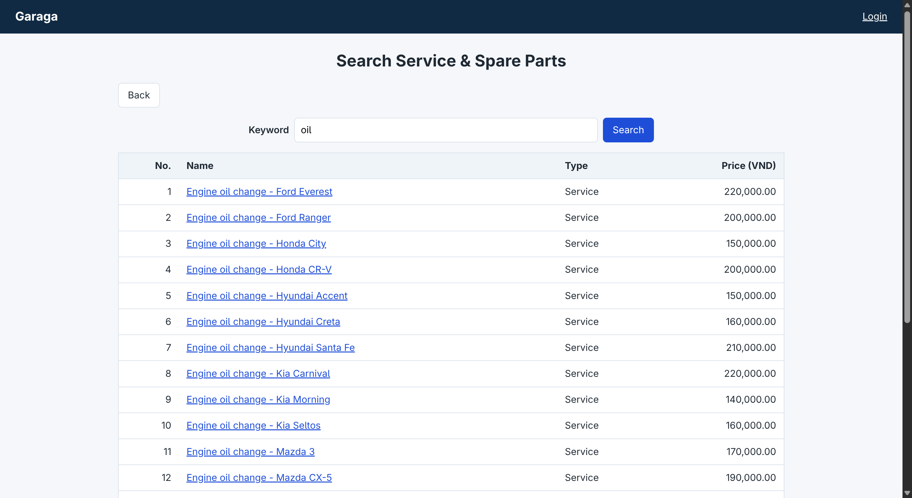
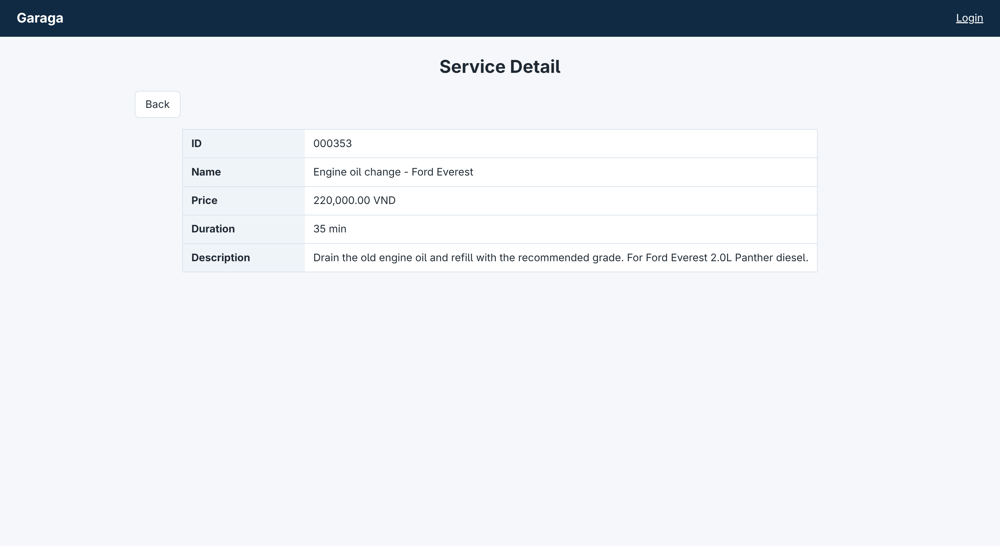
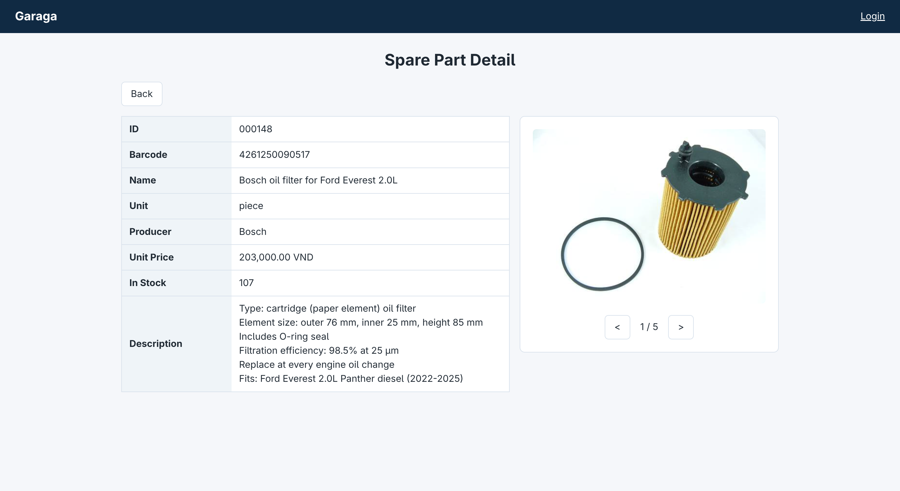
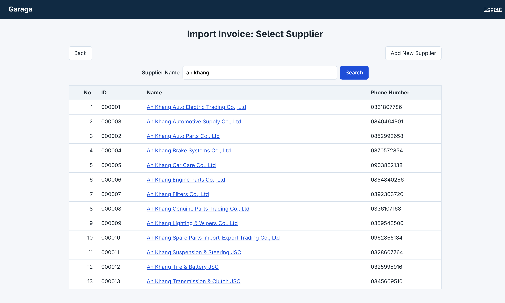
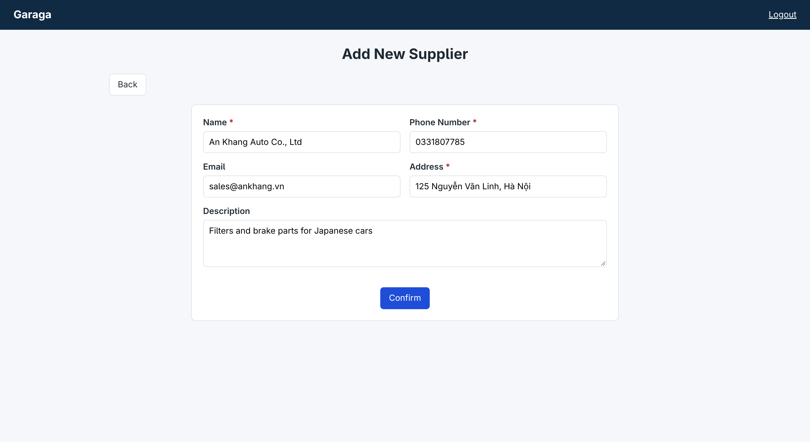
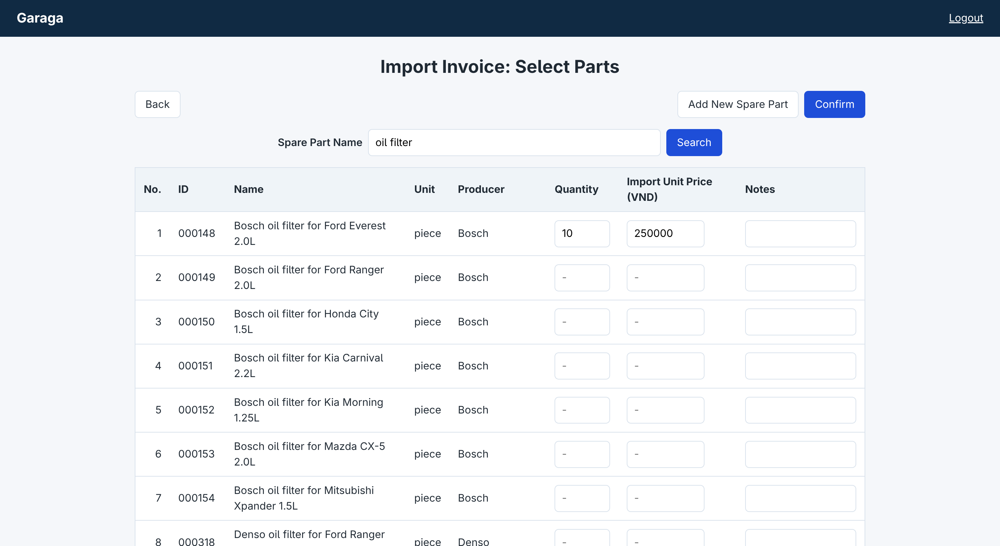
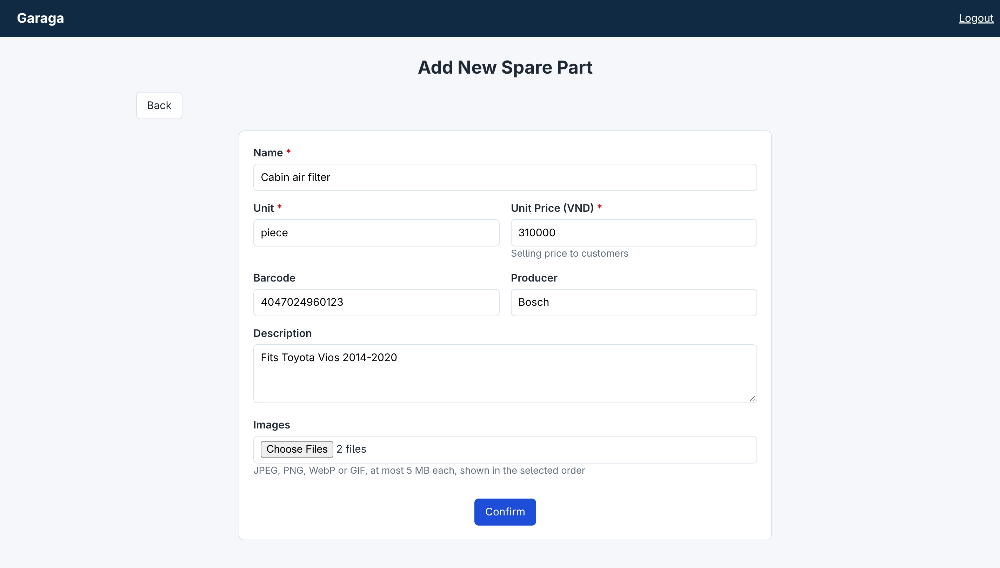
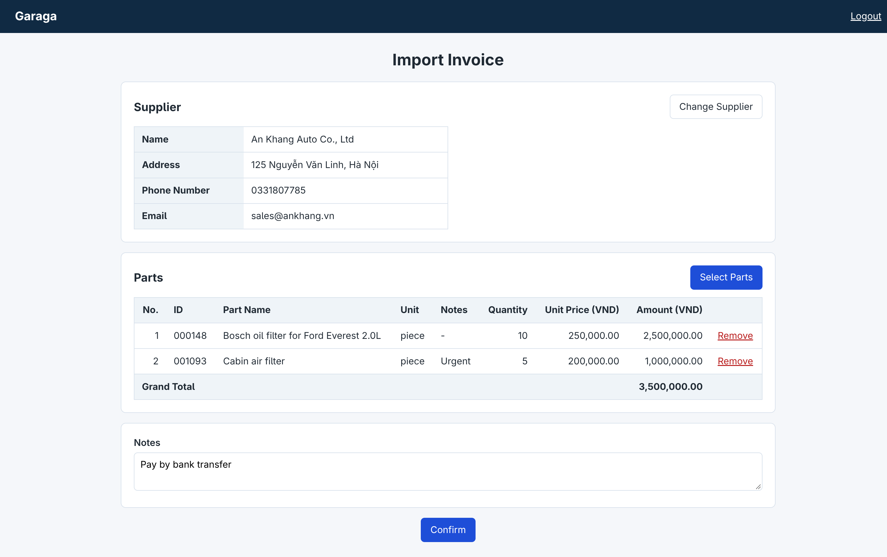
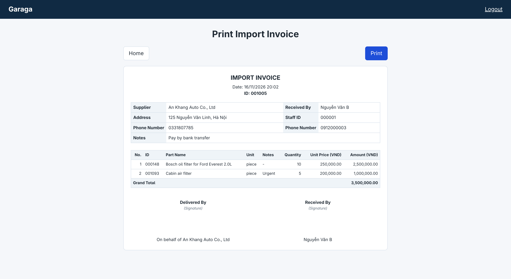

# Garaga

A garage management web app (JSP on Tomcat, PostgreSQL) with two modules: customers search for services and spare parts,
and warehouse staff import spare parts from a supplier.

## Requirements

- Docker with Docker Compose v2

## Build and Run

```sh
git clone https://github.com/Ka-raS/garaga.git
cd garaga
cp .env.example .env
# set POSTGRES_PASSWORD in .env
docker compose up -d --build
# open http://localhost:8080/
```
Sample accounts:
| username | password | role |
| --- | --- | --- |
| `warehouse1` | `123456` | warehouse staff |
| `warehouse2` | `123456` | warehouse staff |
| `customer1` | `123456` | customer |

### Tests

```sh
docker compose run --build --rm test
```

### Stop and Delete database

```sh
docker compose down -v
```

## Screenshots

|  |  |  |
| --- | --- | --- |
|  |  |  |
|  |  |  |
